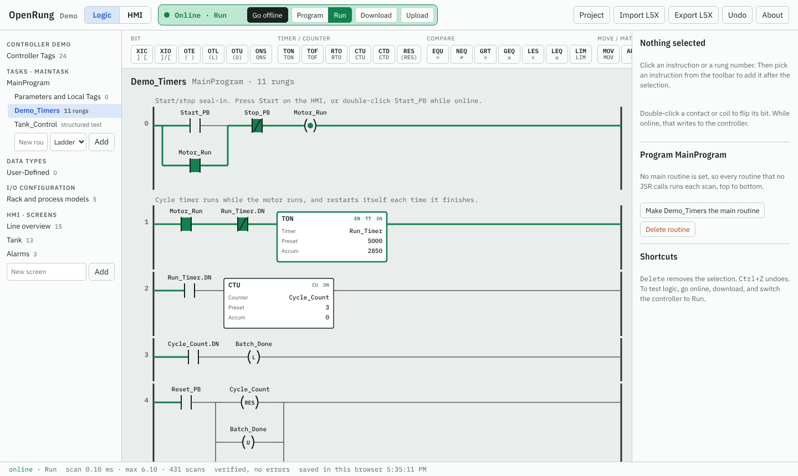
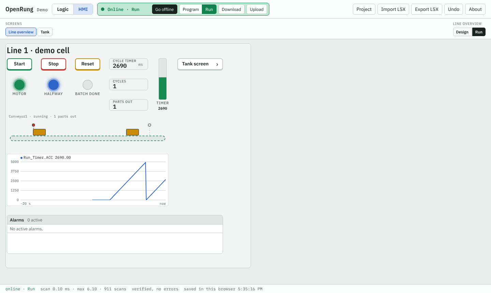
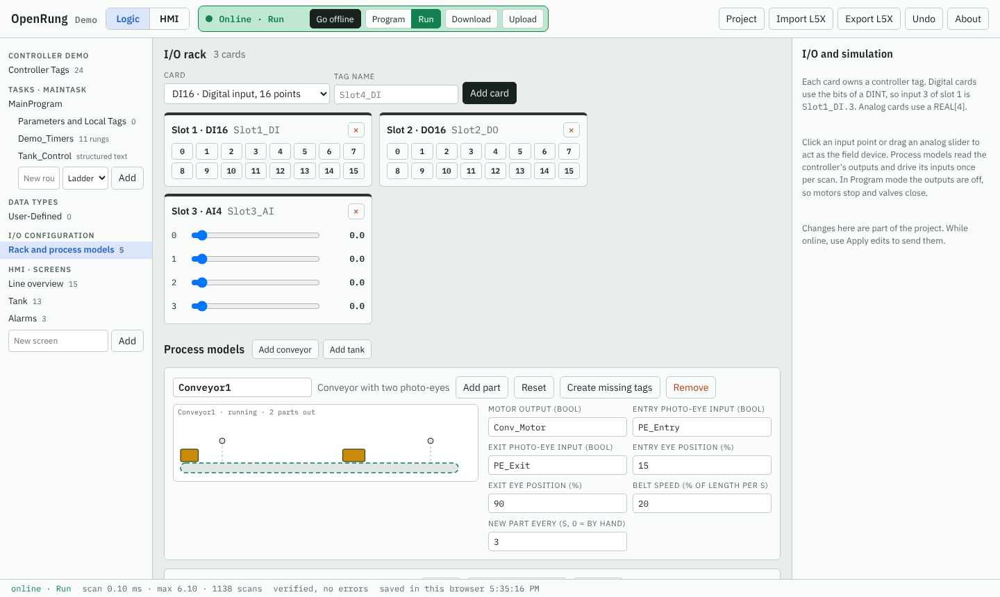

# OpenRung

A free, open source ladder logic editor, virtual controller and HMI that runs in a web browser.
It reads and writes the public L5X XML format, so routines move back and forth with Studio 5000.
Independent clean-room project; not affiliated with Rockwell Automation.

**Built by Ali Jafari, founder of OpenRung.**

**Try it:** https://alijafari21001-glitch.github.io/opening/

## Showcase project
The site opens on the **Showcase** project, a tour of every feature. Start with the `Showcase_Tour` routine: each rung has a comment that says what it shows and how to try it.
- Bit (XIC, XIO, OTE, OTL, OTU, ONS, OSR, OSF, bit addressing), timers (TON, TOF, RTO), counters (CTU, CTD), compare (EQU, NEQ, GRT, GEQ, LEQ, LIM, MEQ), math (ADD, SUB, MUL, DIV, MOD, CPT, CLR, MOV), FLL, COP, an SQO traffic light, AFI and NOP.
- A user-defined type (`Recipe_UDT`) in an array, copied by indirect address; a subroutine with parameters (`Scale_Analog`: JSR, SBR, RET); structured text with CASE, FOR and math functions (`Stats_ST`, `Tank_Control`); servo motion (`Axis_Motion`).
- HMI screens: **Feature tour** (buttons, lamps, numeric entry and display, bar graph, multistate indicator, trend, alarms), **Line overview** (conveyor model), **Tank** and **Axis**.
- Go online, Download, Run, then use the HMI. Drag the I/O sliders, save the project as `.json`, and export any routine as L5X.
To get it back later: **Project › Load the showcase project**.

## Use it
- Open the link above, or download `index.html` and open it in any browser (works offline).
- **Go online** in the top bar, **Download**, then switch the controller to **Run**. The virtual controller runs in a Web Worker and scans every 10 ms; the editor shows live values and power flow.
- The **HMI** tab has a screen designer (buttons, lamps, numeric display and entry, bar graph, tank, multistate, text, screen buttons, trend, alarm list, process view, axis position). Design mode edits, Run mode drives the controller.
- A second tab connects to the same controller. Add `#hmi` to the link to open straight into the operator screens.
- **I/O Configuration** holds a virtual rack (DI16, DO16, AI4, AO4 cards) and process models (a conveyor with photo-eyes, a tank with fill and drain) that act as the machine.
- **Project** saves and opens `.json` project files and keeps a recent-projects list; work autosaves in the browser.
- Import L5X: routine, program, controller or Add-On Instruction exports. Export: one ladder or ST routine, a whole program, or one Add-On Instruction, with the tags, data types and AOIs it needs as context.

## What it covers
- Instructions: XIC XIO ONS OTE OTL OTU OSR OSF TON TOF RTO CTU CTD RES EQU NEQ GRT GEQ LES LEQ LIM MEQ MOV ADD SUB MUL DIV MOD CPT CLR COP FLL SQO JSR SBR RET NOP AFI
- Motion: MSO MSF MAFR MAH MAJ MAM MAS, with the same operands and option words as the L5X rung text, on a simulated servo axis (`AXIS_CIP_DRIVE` or `AXIS_VIRTUAL` tag, `MOTION_INSTRUCTION` control tags). The axis follows its command with trapezoidal moves; homing is immediate. The demo has an `Axis_Motion` routine and an **Axis** HMI screen with a position display. When you import into Studio 5000, assign the axis to a motion group and drive there.
- Structured text routines: assignments, IF/ELSIF/ELSE, CASE, FOR, WHILE, REPEAT, EXIT, RETURN, JSR, math functions.
- Add-On Instructions: Input, Output and InOut parameters (required ones become operands of the box), local tags such as timers, default values, and a ladder or ST `Logic` routine. A tag whose type is the AOI's name is its backing tag, so `Conv[Sel]` style arrays work. Watch one call live by picking a backing tag as the logic's data context. Prescan and EnableInFalse routines are kept but not run.
- Main routine per program; with none set, every routine that no JSR calls runs.
- Controller: Program, Run and Faulted modes, scan time, watchdog, online edits, upload and download.
- Tags: BOOL SINT INT DINT REAL TIMER COUNTER CONTROL AXIS_CIP_DRIVE AXIS_VIRTUAL MOTION_INSTRUCTION, arrays, aliases, user-defined types, AOI backing tags, bit addressing (`Tag.3`).
- `bridge/`: optional Node.js app that serves the tags over Modbus TCP and OPC UA (see its README).
- Not yet: FBD/SFC routines, talking to real hardware.

## Files
- `index.html` is the whole app: one file, no build step.
- `bridge/` is the Modbus TCP / OPC UA helper (`cd bridge && npm install && npm start`).
- `docs/` holds the screenshots.

License: MIT
